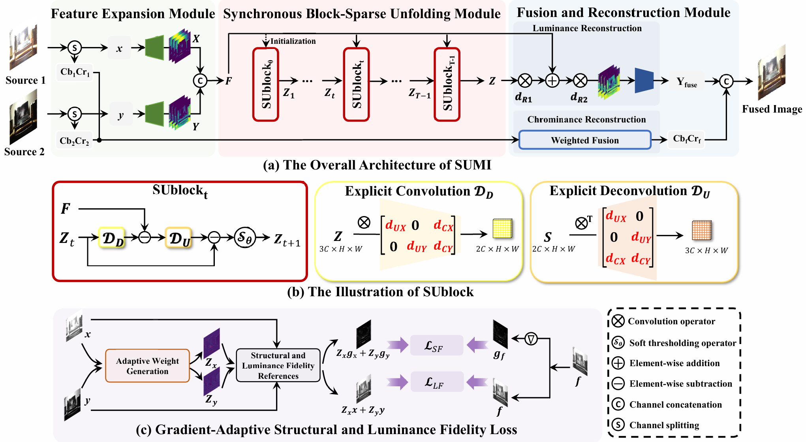

# SUMI: Synchronous Unfolding for Multi-Source Image Fusion

This repository contains the **model definition and sample images** associated with **SUMI**, a lightweight framework for multi-source image fusion based on coupled convolutional sparse coding and synchronous block-sparse unfolding.

**Manuscript:** *Synchronous Block-Sparse Unfolding of Coupled Convolutional Sparse Coding for Lightweight Multi-Modal Image Fusion*.

SUMI is evaluated in the manuscript on multi-exposure, infrared-visible, and medical image fusion. Its design combines source-specific and common representations in a structured unfolding process. The manuscript also introduces a gradient-adaptive structural and luminance fidelity (GSLF) loss for unsupervised training.

> **Naming note:** `CDNet.py` and the `CDNet` Python class retain their original names for compatibility with existing code and checkpoints. **SUMI** is the name used for the current method and manuscript. No model code has been renamed in this repository.

## Repository contents

```text
SUMI-main/
├── CDNet.py                         # SUMI model implementation (legacy filename/class name)
├── README.md
├── input/
│   ├── SourceA/                     # Example images from the first source
│   └── SourceB/                     # Corresponding example images from the second source
├── output/                          # Example fused images
├── workflow.png                     # Earlier architecture figure (CDNet labeling)
├── movitation.png                   # Earlier motivation figure
└── Random-Training-Images-Generation/
    ├── Generate.py                  # Auxiliary random-image generation script
    └── README.md
```

**Release scope:** This archive contains the neural network definition and example images. It does **not** contain a pretrained checkpoint, a batch inference entry point (`infer.py`), or the complete training and image-preprocessing pipeline. In particular, the color-space conversion and chrominance reconstruction described in the paper are **not** implemented in `CDNet.py` itself. The example images in `output/` are provided for reference; they are not produced automatically by running this archive.

## Model implementation

The implementation is in `CDNet.py` and exposes three classes:

| Class | Role |
| --- | --- |
| `Decompose` | Iterative, soft-thresholding-based decomposition with structured convolutional operations. |
| `Fuse` | Lightweight feature fusion and reconstruction using 1 × 1 convolutions. |
| `CDNet` | Two-input fusion network; the class name is retained from the earlier implementation. |

The model operates on **single-channel tensors** in `BHWC` format (`batch × height × width × channel`) with values in `[0, 1]`. Its output has the same layout and a single channel. In the paper's full image-fusion workflow, the network operates on luminance; color processing is handled outside this model file.

### Minimal forward-pass example

Run from the repository root after installing PyTorch:

```python
import torch
from CDNet import CDNet  # Original class name retained

model = CDNet().eval()
source_a = torch.rand(1, 128, 128, 1)
source_b = torch.rand(1, 128, 128, 1)

with torch.no_grad():
    fused = model(source_a, source_b)

print(fused.shape)  # torch.Size([1, 128, 128, 1])
```

This example verifies the **model interface only**. The model starts with randomly initialized parameters; meaningful fusion results require a compatible trained checkpoint and the appropriate inference preprocessing/postprocessing, neither of which is provided in this archive.

## Sample input and output

The repository includes example source pairs with matching filenames:

```text
input/SourceA/0.tif  +  input/SourceB/0.tif
input/SourceA/1.tif  +  input/SourceB/1.tif
...
```

Illustrative fused images are included in `output/`. Because this archive has no batch inference script or weights, the prior commands based on `python infer.py` do not apply to this release.

## Environment

The main model file requires **Python and PyTorch**. The auxiliary random-image generator additionally uses **NumPy, OpenCV, and SciPy**.

The following environment versions were recorded in the previous project README (they are reference versions, not verified minimum requirements):

| Package | Recorded version |
| --- | --- |
| Python | 3.10.20 |
| PyTorch | 2.10.0+cu130 |
| CUDA Toolkit | 13.0.2 |
| NumPy | 2.2.6 |
| OpenCV Python | 5.0.0.93 |
| SciPy | 1.15.3 |

Use a PyTorch installation compatible with your hardware and CUDA driver. The minimal forward-pass example can also be run on CPU.

## Auxiliary random-image generation

`Random-Training-Images-Generation/Generate.py` creates random-noise images and splits them into two complementary sources using irregular masks with partial intensity preservation. This supports the random-input analysis described in the manuscript.

**Path note:** The existing generator writes to hard-coded Windows paths under `F:\\dataset\\Random\\SourceA` and `F:\\dataset\\Random\\SourceB`. Those paths must exist or be adjusted for a different machine before running the script. The script is included unchanged.

## Figures

The archive retains the original image assets:

- `workflow.png` illustrates the model structure, but its annotations still use the former name **CDNet** and earlier module terminology.
- `movitation.png` is a historical motivation figure and includes experimental labels from an earlier manuscript version. It should not be treated as the latest paper's results table.

For current method terminology, experimental protocols, and reported results, refer to the SUMI manuscript.



## Dataset links from the previous README

The following resource links were present in the earlier README. Their availability, contents, and redistribution permissions have **not** been verified as part of this documentation update:

- [Google Drive](https://drive.google.com/file/d/1Hc5OzWD1-7qKylZN-9UajkXgS0tu9NOL/view?usp=drive_link)
- [Quark Drive](https://pan.quark.cn/s/58593be7114c)

## Citation

If you use this repository in academic work, please cite the corresponding **SUMI** manuscript once its bibliographic information is available. No publication DOI is claimed in this repository.